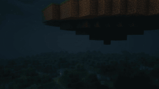
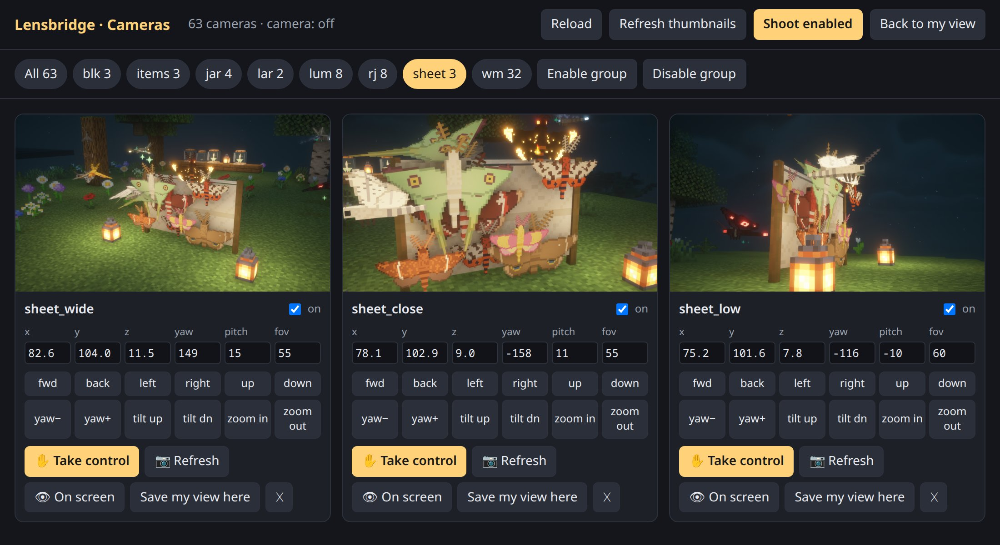
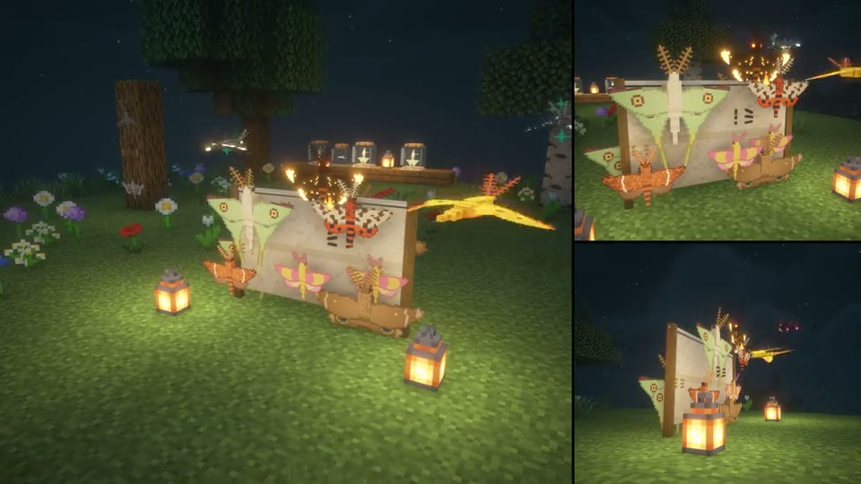
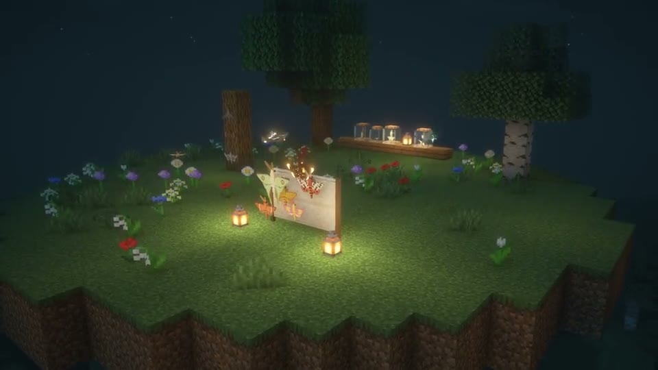
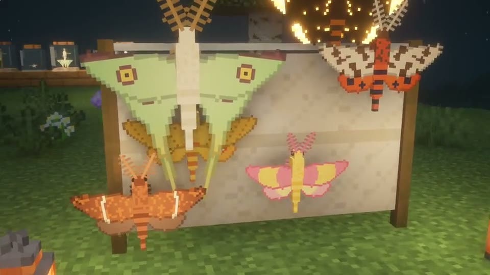
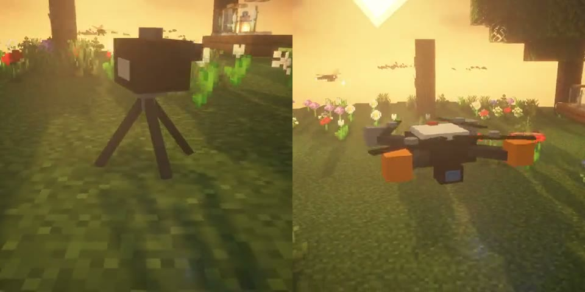
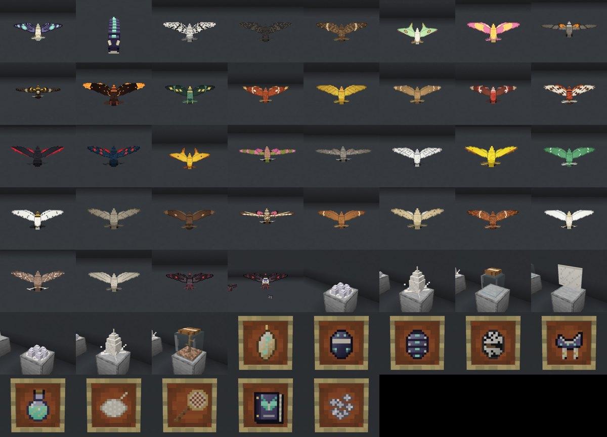

# Lensbridge

[Download](https://apps.zombie.digital/lensbridge) · [Wiki](https://apps.zombie.digital/lensbridge/wiki) · [Releases](https://github.com/joenilan/lensbridge/releases) · MIT licensed

**A film studio and AI bridge for Minecraft.** Place cameras, fly a drone, manage shots in your browser, and record true-speed video. You can also let an AI assistant (via MCP) see the game and shoot screenshots, orbits, camera moves, drone footage and multi-angle videos for you: for mod testing, debugging visuals, and promo material.

<p align="center"><a href="https://www.youtube.com/watch?v=lBERlzQyIzo"></a><br><sub>▶ Watch the behind-the-scenes video: every shot was set up and recorded through Lensbridge</sub></p>

<table>
<tr>
<td width="50%"><br><sub>The Camera Manager in your browser</sub></td>
<td width="50%"><br><sub>Multi-camera recording, synced</sub></td>
</tr>
<tr>
<td><br><sub>Drone shots</sub></td>
<td><br><sub>Camera moves on a rail</sub></td>
</tr>
<tr>
<td><br><sub>Camera and drone props (only crew cameras see them)</sub></td>
<td><br><sub>A Showcase Stage contact sheet, shot automatically</sub></td>
</tr>
</table>

<sub>Pictures are from <a href="https://apps.zombie.digital/mothlight">Mothlight</a>, filmed with Lensbridge.</sub>

| I am... | Read |
|---|---|
| A **player / modmaker** who wants to use it | **[docs/USER_GUIDE.md](docs/USER_GUIDE.md)**: install, hotkeys, Camera Manager, drone, recording, troubleshooting |
| An **AI agent** driving a game | **[docs/AGENT_GUIDE.md](docs/AGENT_GUIDE.md)**: rules, workflows, framing, video, pitfalls; then **[docs/TOOLS.md](docs/TOOLS.md)** |
| Working **on the code** | **[AGENTS.md](AGENTS.md)**, [ROADMAP.md](ROADMAP.md) |

**Quick keys:**

| Key | Action |
|---|---|
| Alt+C | Camera Manager |
| Alt+P | Show cameras in world (props) |
| Alt+T | Place camera |
| Alt+N | Cycle cameras |
| Alt+D | Drone |
| Alt+R | Record |
| Esc | Back to your own view |

The rest of this file is the technical overview.

## Install

1. Put `lensbridge-<version>.jar` in your client's `mods/` folder (NeoForge 21.11.x, MC 1.21.11). It's a client mod: servers don't need it, but a server owner can install it to set the rules (see below).
2. Start the game once. That creates `config/lensbridge.json` with a random **token**:

```json
{
  "enabled": true,
  "host": "127.0.0.1",
  "port": 25599,
  "token": "…random…",
  "captureDir": "lensbridge",
  "previewMaxEdge": 1280,
  "keepRunningUnfocused": true,
  "ffmpeg": "ffmpeg"
}
```

- It only listens on **localhost**, and every request needs `Authorization: Bearer <token>`. Delete the file to get a new token.
- `keepRunningUnfocused` stops the pause menu from popping up when the window loses focus, so the game can be driven in the background.
- Captures go to `<game dir>/lensbridge/` (`screenshots/`, `frames/`, `videos/`).
- Video needs [ffmpeg](https://ffmpeg.org/) on your PATH, or its path set in `ffmpeg`.

### Connect Claude Code

```bash
claude mcp add --transport http lensbridge http://127.0.0.1:25599/mcp \
  --header "Authorization: Bearer <token from config/lensbridge.json>"
```

Any MCP client that speaks Streamable HTTP works the same way.

### Scripts / curl (REST mirror)

```bash
T=<token>
curl -H "Authorization: Bearer $T" -d '{}' http://127.0.0.1:25599/api/status
curl -H "Authorization: Bearer $T" -d '{"hide_hud":true}' http://127.0.0.1:25599/api/screenshot
curl -H "Authorization: Bearer $T" http://127.0.0.1:25599/api/          # list tools + schemas
```

`POST /api/<tool>` with the arguments as the JSON body. It returns `{"content":[{type:text|image,…}],"isError":false}`. `GET /health` needs no token.

### With Agentlink (optional)

**Agentlink** (not released yet) is a separate bridge mod that any mod can plug tools into (Mothlight, Murmur, ...), so one MCP
connection drives all of them. **Lensbridge does not need it.** If Agentlink is installed, Lensbridge doesn't start its own
server; it hands its tools, the Camera Manager and the docs pages to Agentlink instead. Nothing changes for you:

- Same address and token: on its first start Agentlink copies `port` and `token` from `config/lensbridge.json` into
  `config/agentlink.json`, so your MCP client keeps working. From then on the token lives in `config/agentlink.json`.
- Same tool names (`status`, `capture_orbit`, ...). On Agentlink they also answer to `lensbridge.<tool>`.
- Alt+C opens the Camera Manager on Agentlink's address.
- Extra tools from Agentlink itself: `list_capabilities` (every mod plugged in) and `poll_events`.

---

## Tools

| Group | Tool | What it does |
|---|---|---|
| Observe | `status` | in-world?, open screen, position/rotation/dimension, health, gamemode, time, weather, FPS, window, director camera |
| | `screenshot` | game-only capture; saves a full-size PNG and returns a preview (`hide_hud`, `name`, `settle_frames`) |
| | `inspect` | crosshair block/entity, nearby entities (type, name, position, distance, HP, id), hands and hotbar |
| | `chat_log` | received chat and system lines, numbered (`since`) |
| | `wait` | ticks / frames / milliseconds |
| Act | `command` / `chat` | send a command (no `/` needed) or a chat message |
| | `look` | absolute yaw/pitch, or look at x/y/z |
| | `hold_keys` | hold keys for N ticks: `forward back left right jump sneak sprint use attack drop`, or any key mapping id such as a mod hotkey |
| | `press` | tap a key once (click) |
| | `hotbar` / `close_screen` / `release_inputs` | pick a slot, close GUIs, release everything |
| Direct | `camera_set` / `camera_look_at` / `camera_release` | free director camera (absolute or player-relative; roll; FOV) |
| | `hud` / `window_size` | F1 toggle; resize the window (sets the capture resolution) |
| | `scene` | `time`, `weather`, `freeze`, `step`, `lock_time` (needs op) |
| Cinema | `find_entities` | find loaded mobs by type or name; returns the ids to lock onto |
| | `camera_lock` | **target lock**: the camera holds position and smoothly keeps a moving target framed |
| | `camera_orbit` | **live 360° orbit** around a target; follows it as it moves (speed, radius, height, sweep) |
| | `camera_pan` | **360° pan** from a fixed spot (speed, sweep, pitch) |
| | `camera_rail` | **rail cam** along a saved path or keyframes; once / loop / pingpong; optional target lock |
| | `camera_follow` | **chase cam** behind/above a target relative to its facing, smoothed (riding, flying shots) |
| | `camera_dolly_zoom` | **vertigo** shot: pushes in while widening the FOV so the subject keeps its size |
| | `capture_program` | render the playing move **frame-exact** → MP4. With `scene freeze` + `tick_step:1` at 20 fps, moving mobs advance exactly one tick per frame |
| Drone | `drone_fly` | **physics drone**: inertia, speed/accel limits, banking, stabilised gimbal, hover wobble, ground clearance. Autonomous modes: `hover`, `mission` (waypoints + holds), `orbit`, **`follow`** (automatic aerial follow-me), `dronie`, `reveal`, `topdown`, `fpv` (racing lines, no gimbal), `pilot` |
| | `drone_control` / `drone_status` | stick inputs for pilot mode; telemetry (altitude, speed, yaw, gimbal) |
| Tripods | `tripod_place` / `tripod_ring` | fixed cameras at your view or aimed at a point; tracking tripods follow a target; a ring of N angles around a subject |
| | `tripod_shots` | multi-angle stills from every tripod + one contact sheet |
| | **`multicam`** | **synced multi-angle video**: steps the frozen world tick by tick and renders every tripod each tick, giving one MP4 per angle with identical action |
| | `tripod_view` / `tripod_list` / `tripod_remove` | look through, list, remove |
| Paths | `path_mark` | build a rail interactively: append the current view as a keyframe |
| | `path_save` / `path_get` / `path_list` / `path_delete` | named paths in `config/lensbridge/paths/` |
| | `path_show` | preview the rail in-world with particles (only on your client) |
| Capture | `capture_orbit` | turntable around a point → frames → MP4 (+GIF) + contact sheet |
| | `capture_path` | Catmull-Rom camera move through keyframes (`look_at`, FOV, roll, easing) → MP4 |
| | `record` | real-time recording of the live view → MP4 (gameplay clips) |
| | `list_captures` | recent files with full paths |

Targets everywhere: `{"entity": id}`, `{"nearest": "mothlight:lumen"}`, `{"point": [x,y,z]}` or `{"player": true}`, with an optional `"offset": [dx,dy,dz]`.

### Showcase Stages (for modmakers)

`stage_build {"namespace":"yourmod"}` builds a clean display of every mob, block and item in your mod high in the sky; `stage_shoot` photographs each one (plus a contact sheet, an index page and optional turntables) into `lensbridge/showcase/yourmod/`; `stage_clear` removes it. Variants go in `extra`.

### Camera Manager (browser panel)

Press **Alt+C** in game (or open `http://127.0.0.1:25599/ui#<token>`). Every camera appears as a card with a thumbnail, grouped by name prefix. On each card you can:
- turn it on or off (shoots and multicam use enabled cameras)
- edit x/y/z/yaw/pitch/FOV
- nudge it (fwd/back/left/right/up/down, yaw, tilt, zoom); the thumbnail re-renders automatically
- show it on your screen
- **✋ Take control:** your in-game view becomes that camera. Fly it precisely (WASD/Space/Shift, Sprint for speed, mouse to look, **scroll to zoom**), then press **Enter** to save the view into the camera, or **Esc**/**Backspace** to cancel. You're dropped back to your own view, the thumbnail refreshes, and the panel updates. There are Save/Cancel buttons in the panel too.
- **save your current view** into it (fly the drone with Alt+D, find the angle, click)
- delete it

There are also group enable/disable controls and **Shoot enabled**. Thumbnails render in stealth, so your screen never changes. The same functions are available to AI as `tripod_all`, `tripod_update`, `tripod_nudge`, `tripod_thumbs`, `tripod_preview` and `tripod_set_from_view`.

**Getting out of any camera mode:** press **Esc** (or Backspace) in game. It cancels an edit, lands the drone, or leaves a previewed camera, and only opens the pause menu when no camera mode is active. The panel's **Back to my view** button (or the `exit_camera` tool) does the same.

### In-game camera controls (for players)

| Key (rebindable, "Lensbridge Camera"; all use Alt so they don't clash with map/minimap mods) | Action |
|---|---|
| **Alt+D** | Fly the drone: WASD fly, Space/Shift up/down, Sprint fast, mouse = yaw + gimbal. Your player stays put. Alt+D lands. |
| **Alt+T** | Place a tripod at the current view |
| **Alt+N** | Cycle through tripod views, then back to you |
| **Alt+R** | Start/stop recording (30 fps, HUD hidden) → MP4 in `lensbridge/videos/` |
| **Alt+C** | Open the Camera Manager in your browser |
| **Alt+P** | Show or hide your cameras as props in the world (your shots stay clean) |

A small HUD shows drone telemetry, the active camera and recording time; it's hidden whenever the HUD is hidden.

### Drone recipe

```text
drone_fly {"mode":"follow","target":{"player":true},"distance":7,"height":5,"fov":70}   # automatic aerial follow-me
record    {"seconds":8,"fps":30,"hide_hud":true}                                     # while you (or a mob) move
drone_fly {"mode":"dronie","target":{"nearest":"mothlight:lumen"},"seconds":8,"distance":22,"height":14}
capture_program {"seconds":9.5,"fps":30,"name":"dronie"}                             # frame-exact
tripod_ring {"cx":10,"cy":65,"cz":4,"count":4,"radius":4.5} ; multicam {"seconds":4} # 4 synced angles
```

### Cinematic recipe

```text
find_entities   {"type":"mothlight:lumen"}                                  # → id 4321
camera_orbit    {"target":{"entity":4321},"radius":3,"height":0.8,"speed":30,"fov":50}
screenshot      {"hide_hud":true}                                           # check the framing
capture_program {"seconds":12,"fps":30,"name":"lumen_orbit"}                # frame-exact 360° → MP4

path_mark {"name":"glide","reset":true}   ... move the view ...   path_mark {"name":"glide"}  (repeat)
path_show {"name":"glide"}                                                  # see the rail
camera_rail {"path":"glide","seconds":10,"target":{"nearest":"mothlight:lumen"}}
record {"seconds":10,"fps":30}                                              # live, real time

scene {"freeze":true}                                                       # perfectly smooth moving subjects:
camera_follow {"target":{"entity":4321},"distance":3}
capture_program {"seconds":5,"fps":20,"tick_step":1,"name":"chase"}
```

### Promo recipe

```text
scene        {"time":"sunset","weather":"clear","freeze":true}     # everything holds still
window_size  {"width":1920,"height":1080}
camera_look_at {"x":10,"y":70,"z":4,"tx":12,"ty":68.5,"tz":8,"fov":50}
screenshot   {"hide_hud":true,"name":"hero_shot"}
capture_orbit {"cx":12,"cy":68.5,"cz":8,"radius":4,"height":1.2,"frames":240,"fps":60,"name":"turntable","gif":true}
capture_path {"seconds":8,"fps":60,"keyframes":[{"x":0,"y":72,"z":0,"look_at":[12,68,8]},
              {"x":8,"y":70,"z":2,"look_at":[12,68,8],"fov":45},{"x":14,"y":69,"z":5,"look_at":[12,68.5,8],"fov":35}]}
scene        {"freeze":false}
camera_release {}
```

**Speed is always true unless you ask for a timelapse.**
- `record` captures in **real time**: frames stream straight into ffmpeg, and if a grab is late the previous frame is repeated, so a 7 s clip is exactly 7 s of game time.
- `capture_orbit`, `capture_path`, `capture_program` and `multicam` render frame by frame, so the camera is always smooth. `world` controls the world during the render:
  - `sync` (default): the server tick rate is scaled to the capture speed, and frames are paced when capture is faster than real time, so mobs move at their true speed.
  - `step`: frozen, then stepped exactly 20/fps ticks per frame, for perfect smoothness.
  - `frozen`: everything held still.
  - `free`: the world runs at full speed = a timelapse look.
- **Timelapse on purpose:** `record {"seconds":120,"timelapse_interval":2}` takes one frame every 2 s of game time.

---

## Limits

- The director camera only shows chunks the player has loaded. For far shots, move the player too (spectator + `/tp`).
- The capture resolution is the window size. Use `window_size` for 1080p, 1440p or 4K-wide windows.
- `command`, `scene` and other world changes need op on the server.
- **Multiplayer manners:** on a server, free cameras (they see through walls) need operator status or spectator mode, and tools that act as the player (`look`, `hold_keys`, `press`, `hotbar`, `chat`, `command`, `screen_*`) need operator status. Singleplayer is unrestricted. A server that installs Lensbridge sets its own rules in `config/lensbridge-server.toml` (`freeCameras`, `aiControl`: OPS / EVERYONE / NOBODY) and permission mods can use the nodes `lensbridge.free_cameras` and `lensbridge.ai_control`. See the user guide, "Playing on servers".
- If the game window is minimised, nothing renders and captures time out.

See [ROADMAP.md](ROADMAP.md) for what's next.

## Build

```bash
./gradlew build      # → build/libs/lensbridge-<version>.jar
```

## License

MIT
